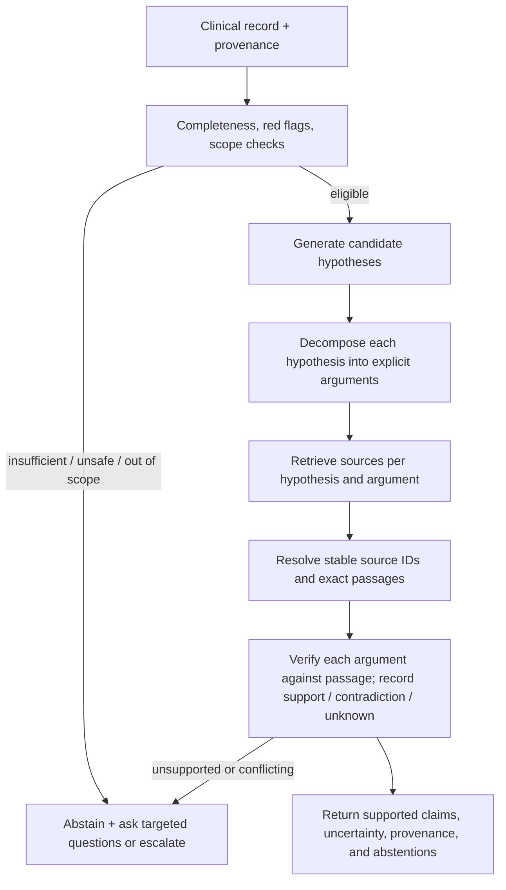

# HELIX application: evidence boundaries and evaluation plan

This note describes what the current application code does and what evidence is still
missing. It does not report new model results, a live deployment inspection, or a test
run. The diagnosis and reference paths were reviewed in `app/api/diagnose/route.ts`,
`lib/references/pubmed.ts`, `lib/ai/model-gateway.ts`, `lib/api-validation.ts`,
`types/index.ts`, and `.env.example`.

## Current evidence boundary

- The model gateway sends a configurable `model` string (`MEDICAL_MODEL_NAME`, default
  `helix-medical`) to an OpenAI-compatible endpoint. The application does not load model
  weights or attest which weights serve that name. Configuration is not deployment
  evidence.
- No evaluated result is established here for a trained model on the application's
  actual structured diagnostic task: clinical input to JSON hypotheses, arguments,
  differentials, suggestions, and ICD-10 codes. Results from a separate training
  repository or a different model/task cannot fill that gap without a compatible,
  reproducible evaluation.
- `haute`, `moyenne`, and `faible` are accepted enum values in the response schema. They
  have no calibration evidence here; optional numeric `score` is likewise not evidence
  of a calibrated probability.
- When a complaint or HMA is present, the diagnosis prompt requires at least one
  plausible hypothesis even when information is incomplete. The route retries an empty
  hypothesis list with another instruction to produce one. Safe abstention is not a
  current outcome of this flow.
- PubMed search is constructed from the first hypothesis only. The returned article
  metadata is not checked for clinical support of any particular argument. There is no
  per-argument entailment check, verified source-passage record, or proof that cited
  literature supports statements about the individual patient.
- `fetchPubMedReferences` returns `[]` both when search returns no usable IDs and when
  a fetch, HTTP, timeout, or parsing path throws. The API response therefore cannot
  distinguish “no results” from “lookup failed”; the empty list must not be presented as
  proof that no literature exists.
- The diagnosis route removes selected structured identity fields before sending the
  patient-record summary, but it does not scrub names, addresses, dates, record IDs, or other
  identifying details from free text. Removing those named fields is not a guarantee of
  de-identification.

## Proposed future evidence-grounded flow (not current behavior)

The following is an architectural proposal only. It is not implemented by the current
diagnosis route or PubMed client.

A future implementation should preserve, for every claim, the patient facts used, the
source identifier and revision, the exact retrieved passage, the relation label
(`supports`, `contradicts`, `not addressed`), and the verification method. Retrieval
similarity alone is not entailment. Patient-specific assertions require evidence from the
patient record; a PubMed article can provide general evidence, not proof that the patient
has a condition. Keep source retrieval, claim verification, and clinical adjudication as
separate stages.

## Missing evidence and useful future metrics

1. **Model provenance and reproducibility:** capture immutable endpoint/deployment ID,
   model weights and tokenizer revisions, prompt/schema versions, decoding settings,
   and request IDs in a privacy-preserving evaluation manifest. Verify the serving
   artifact independently; a request's model label is insufficient.
2. **Structured diagnosis task:** create a locked, independently adjudicated set matching
   the app input/output contract. Report per-case and per-specialty denominators; top-1
   and top-k diagnosis performance; macro-F1; ICD-10 exact and clinically equivalent
   match rates; argument-level supported/unsupported/omitted rates; suggestion
   appropriateness; JSON/schema failure rate; and confidence intervals. Predefine
   handling of multiple acceptable diagnoses, missing data, and abstentions.
3. **Calibration and abstention:** evaluate calibration only if the output has a defined
   numeric probability and target event. Report reliability plots, Brier score or log
   loss, calibration error with its binning method, and selective risk/coverage across
   abstention thresholds. Separately measure whether red flags are escalated and whether
   incomplete or out-of-scope cases abstain safely. Do not map the current three labels
   to numeric probabilities without evidence.
4. **Evidence linking:** assess retrieval precision/recall against curated relevant
   sources; passage-level support/contradiction/unknown labels by blinded reviewers;
   citation correctness and freshness; and unsupported-claim rate per argument. Count a
   citation as support only when the cited passage entails the stated claim. Report
   patient-specific claims separately from general medical claims.
5. **PubMed outcomes:** distinguish `success_with_results`, `success_no_results`, and
   `lookup_error` (including timeout, HTTP, and parse failure). Measure query relevance,
   retrieval coverage, duplicate/stale citation rate, and latency on a fixed benchmark.
   Evaluate each hypothesis independently rather than using only the first candidate.
6. **Privacy and robustness:** test direct identifiers and identifying details in every
   free-text field, prompt-injection content, malformed inputs, and accidental logging.
   Report leak-detection sensitivity on synthetic fixtures and false positives, not on
   real patient data. This plan does not assert that names-only removal sanitizes free
   text.
7. **Human factors and safety:** blinded clinician review of usefulness, omission and
   automation-bias risks; escalation appropriateness; and subgroup analysis by specialty,
   age group, sex, language, and data completeness. Define adjudication and disagreement
   resolution before testing.

Use paired model comparisons on identical locked cases and prompts, report all
predeclared outcomes including null/negative findings, and separate benchmark evidence
from prospective clinical validation. Do not invent acceptance thresholds after seeing
the results; have clinical owners define them before evaluation.

## Project boundaries

- [Application personal repository: `zadbox/helix-brain-health`](https://github.com/zadbox/helix-brain-health)
- [Training fork: `zadbox/BRAIN-train`, `Training_v2`](https://github.com/zadbox/BRAIN-train/tree/Training_v2)
- [BrainMed personal repository: `zadbox/BrainMed-8B`](https://github.com/zadbox/BrainMed-8B)

The application, the HELIX training pipeline/artifacts, and BrainMed are distinct
lineages. Neither a configurable application gateway nor results from a separate model
or task establish which weights are deployed here or validate the application's
structured diagnostic outputs.
